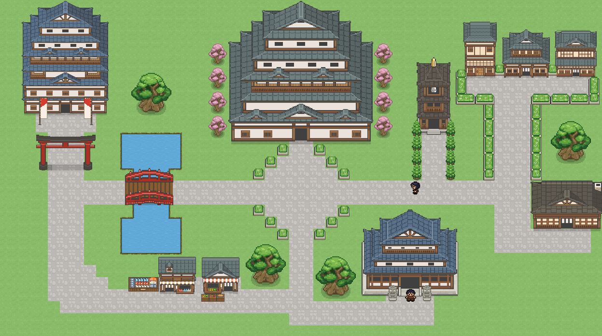

# KOTOWAZA

*A quiet journey through a world inspired by Japanese proverbs.*

---

## Overview

**Kotowaza (ことわざ)** is a top-down, pixel-art exploration game inspired by the beauty, atmosphere and philosophy of rural Japan.

Wander through a carefully crafted village, discover its inhabitants, explore winding paths and uncover the small details hidden throughout the world.

Designed around a sense of tranquillity and discovery, Kotowaza invites you to slow down, explore at your own pace and enjoy the journey.

## The World

A handcrafted landscape brought to life through detailed pixel art, natural scenery and traditional Japanese influences.

- **Exploration** — Discover the village and its surrounding landscape.
- **Characters** — Meet villagers and experience their daily routines.
- **Atmosphere** — Immerse yourself in a peaceful world of winding paths, greenery and seasonal scenery.
- **Discovery** — Find hidden locations and uncover the stories behind the world.

## Controls

| Action | Input |
|:---|:---|
| Movement | `W` `A` `S` `D` / Arrow Keys |
| Toggle Route Finding | `N` |
| Toggle Hitboxes | `H` |
| Menu | `TAB` |
| Exit | `ESC` |

## Gallery

## Credits

| Contribution | Creator |
|:---|:---|
| Game Design & Programming | Bubsee |
| Artwork | VectorRaith |

---

**ことわざ**

*Take your time. Enjoy the journey.*

